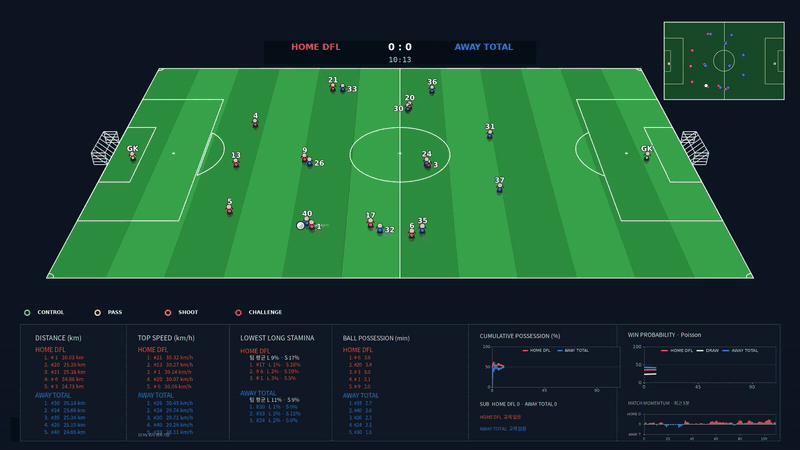

<div align="center">


<h1>MESSI</h1>

<strong>A JAX-based football match environment</strong>

<p>
  <a href="assets/intro-10s.mp4">
    
  </a>
</p>

<sub>A 10-second excerpt (00:13–00:23) from the introduction video. Select the GIF to watch the MP4 clip.</sub>

</div>

---

MESSI is a JAX-based football match simulation environment with built-in rule-based policies. It supports batches of independent matches and represents match transitions and policy inputs as fixed-shape data suitable for JAX transformations.

## Getting started

Python 3.11 or later is required.

```bash
python -m pip install -e .
```

For GPU support, follow the [official JAX installation guide](https://docs.jax.dev/en/latest/installation.html) for your device and CUDA version. On a shared server, select a specific GPU before starting Python, for example with `CUDA_VISIBLE_DEVICES=0`. For CPU execution, set `JAX_PLATFORMS=cpu`.

This example creates a default roster and advances one control frame with the rule-based policy.

```python
import jax
import messi

reset_key, policy_key, frame_key = jax.random.split(jax.random.key(0), 3)
episode = messi.reset_environment(reset_key)
observation = messi.observe_policy(episode.state, episode.roster)
action = messi.rule_policy(observation, key=policy_key)
result = messi.transition_match(
    episode.state,
    episode.roster,
    action,
    frame_key,
    episode.setup,
)
print(result.state.score, result.reward, result.done)
```

An external policy can take `PolicyObservation` as input, produce an `IntentAction`, and pass it to `transition_match` or a rollout API. Use separate random keys for reset, stochastic policy decisions, and match transitions.
`result.state` is the next match state, `result.reward` contains score-based rewards for both teams, and `result.done` indicates termination or a time limit. The module guides below describe the contracts in more detail.

## Project structure

- [`messi/core/README.md`](messi/core/README.md): action and state contracts, physics, and match rules
- [`messi/environment/README.md`](messi/environment/README.md): reset, observations, match clock, and management APIs
- [`messi/policies/README.md`](messi/policies/README.md): built-in rule-based policies and tactical plans
- [`messi/analysis/README.md`](messi/analysis/README.md): bounded match recording and detailed reports
- [`messi/rendering/README.md`](messi/rendering/README.md): JSON, Markdown, HTML, and optional MP4 exports

## Scope and limitations

- The default match lasts 90 minutes across two halves, with up to 10 minutes of added time per period. Match timing and physics resolution are configurable.
- The supplied rule-based policies are part of the environment. They do not constitute a complete implementation of official football rules or a reproduction of any particular league's policies.
- Consult the public APIs and module guides for action, observation, and state contracts. Features without an implementation or verification should not be assumed to work.

## Attribution

MESSI was originally developed and maintained by **Hyunwoo Park** at CIDA Lab,
University of Seoul.

## Citation

If you use MESSI in research, cite the software and identify the Git commit used.
This BibTeX entry describes the repository; it does not represent a published paper.

```bibtex
@software{park_messi_2026,
  author    = {Park, Hyunwoo},
  title     = {{MESSI}: A Multi-agent Match Environment for Soccer Simulation and Intelligence},
  year      = {2026},
  publisher = {CIDA Lab, University of Seoul},
  url       = {https://github.com/UoS-CIDA-Lab/MESSI},
  note      = {Software; cite the exact Git commit used}
}
```
